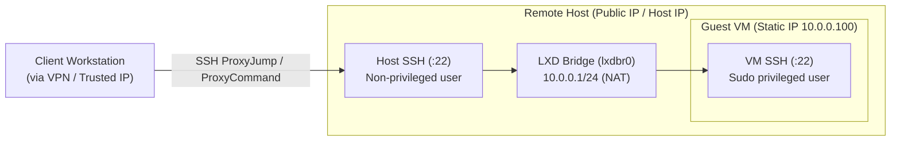
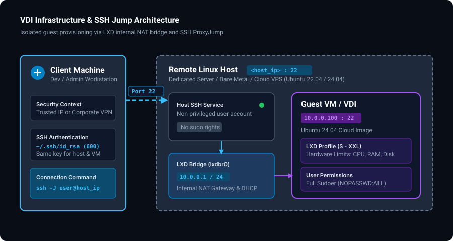

# VDI & VM Provisioning Tools

## Description
This repository contains automation scripts to provision and configure isolated virtual machines (VMs) on any remote Linux host (dedicated server, bare metal, or cloud VPS with nested virtualization enabled — such as Hetzner, OVH, AWS, GCP, DigitalOcean, Proxmox, or a home lab).

Three deployment approaches are provided:
- **Incus (Recommended Community Fork)**: Uses [Incus](https://linuxcontainers.org/incus/) (Linux Containers fork of LXD) via native `.deb` packages from Zabbly (no Snap required). See [`incus/README.md`](./incus/README.md).
- **LXD**: Uses Canonical LXD via Snap and Ansible. See [`lxd/README.md`](./lxd/README.md).
- **KVM-QEMU / Vagrant**: Uses HashiCorp Vagrant with the `vagrant-libvirt` provider. See [`kvm-qemu/README.md`](./kvm-qemu/README.md).

The primary entrypoint is [`incus/setup.sh`](./incus/setup.sh) (or [`lxd/setup.sh`](./lxd/setup.sh)).

## Prerequisites
- **Host OS**: Ubuntu (22.04 or 24.04 LTS recommended).
- **Virtualization Support**: CPU virtualization extensions (Intel VT-x or AMD-V) must be enabled on the host. If running inside a cloud VPS, nested virtualization must be supported and active.
  ```bash
  # Verify KVM acceleration support:
  kvm-ok
  # or check CPU flags:
  egrep -c '(vmx|svm)' /proc/cpuinfo
  ```
- **Privileges**: Root or sudo access on the host to run initial installation scripts.

## About LXD
LXD is a next-generation system container and virtual machine manager by Canonical. It can run both system containers (lightweight OS instances sharing the host kernel) and full virtual machines (built on KVM-QEMU with isolated hardware emulation).

LXD provides a clean RESTful API, a CLI (`lxc`), hardware profiles, snapshotting, and clustering capabilities, making it simpler to automate than raw QEMU/libvirt setups.

## Why LXD over KVM-Qemu
While raw KVM-QEMU / libvirt requires verbose XML domain definitions or CLI flags, LXD wraps KVM in an API and declarative profile model. This makes management with Ansible, Terraform, or simple bash scripts straightforward.

## High Level Overview





### Security Model & Core Assumptions:
- **Secured & Tunneled Host Assumption**: This architecture **strictly assumes** that your remote host is already hardened, tunneled, and that **port 22 (SSH) is only accessible from your trusted IP address range or through a private/corporate VPN**.
- **No Public VM Exposure**: Virtual machines live in an isolated internal NAT bridge (`10.0.0.0/24`) with zero public exposure. Connections from the client reach the VM via SSH ProxyJump (`ssh -J`), routing through the host without exposing any VM ports to the outside world.
- **Host vs. VM Privileges**: The user account created on the host is non-privileged (no sudo), preventing accidental or intentional modification of host networking, firewall, or neighboring guests. Inside the VM, the user has full sudo permissions.
- **Key Pair**: The same SSH keypair is configured for both the host and the VM for seamless ProxyJump authentication.

> [!WARNING]
> **Host Exposure Responsibility**: Exposing port 22 openly to the entire internet (`0.0.0.0/0`) without IP whitelisting or a VPN tunnel exposes the host to constant brute-force attempts and is strictly at your own risk and responsibility.

## Key Considerations:
- **Ansible Installation**: Installed from the official Ansible PPA rather than standard distro packages to ensure compatibility with modern Ansible collections (`community.general`).
- **Network Isolation**: LXD uses a private bridge network (`lxdbr0`) configured with CIDR `10.0.0.0/24` and NAT enabled via `preseed.yaml`.
- **Static IP**: The VM profile overrides the `eth0` device to bind the guest to static IP `10.0.0.100`.
- **Modular Playbooks**: Host preparation ([`setup_host.yaml`](./lxd/setup_host.yaml)) and VM guest configuration ([`setup_vms.yaml`](./lxd/setup_vms.yaml)) are separated for clarity and reusability.

## Host & Cloud Firewall Setup (Sample Configuration)

> [!IMPORTANT]
> The rules below are a **sample reference configuration** illustrating how a provider firewall (such as Hetzner Cloud Firewall, AWS Security Groups, GCP Firewall) or local `ufw` should restrict traffic. You must replace `<trusted_ip_or_vpn>/32` with your actual VPN gateway or trusted workstation IP. 

Regardless of where your host is hosted (Hetzner, AWS, OVH, DigitalOcean, bare-metal, etc.), the host only requires SSH access inbound from your trusted source, and outbound internet access for packages and images.

### Firewall Rule Specification

#### Incoming Rules (Inbound)
| # | Rule Name | Protocol | Source IP | Destination Port | Action | Purpose |
|---|---|---|---|---|---|---|
| 1 | `icmp-ping` | ICMP (IPv4) | `<trusted_ip_or_vpn>/32` | Any | **Accept** | Diagnostic ping from trusted IP |
| 2 | `ssh` | TCP (IPv4) | `<trusted_ip_or_vpn>/32` | `22` | **Accept** | Restricts SSH access exclusively to your workstation / VPN |
| 3 | `tcp-established` | TCP (IPv4) | `0.0.0.0/0` | Any (TCP ACK) | **Accept** | Allows return traffic for established connections |
| 4 | `default-deny` | All | `0.0.0.0/0` | Any | **Discard / Drop** | Blocks all unsolicited incoming traffic |

#### Outgoing Rules (Outbound)
| # | Rule Name | Protocol | Destination IP | Destination Port | Action | Purpose |
|---|---|---|---|---|---|---|
| 1 | `block-smtp-25` | TCP | `0.0.0.0/0` | `25` | **Discard / Drop** | Prevents outbound spam on unencrypted SMTP |
| 2 | `block-smtps-465` | TCP | `0.0.0.0/0` | `465` | **Discard / Drop** | Prevents outbound spam on SMTPS |
| 3 | `allow-all-outbound` | All | `0.0.0.0/0` | `0-65535` | **Accept** | Allows OS upgrades, package downloads, and container image pulls |

### Local Host Firewall Configuration (`ufw`)
If you are running on a bare-metal server without a cloud provider firewall, you can apply equivalent rules locally using `ufw`:
```bash
# Default policies
sudo ufw default deny incoming
sudo ufw default allow outgoing

# Allow SSH only from trusted IP or VPN CIDR
sudo ufw allow from <YOUR_IP_OR_VPN_SUBNET> to any port 22 proto tcp

# Block outbound mail ports
sudo ufw deny out 25/tcp
sudo ufw deny out 465/tcp

# Enable firewall
sudo ufw enable
```

## Provisioning VMs

### Default Deployment
Run the entrypoint script on the host as root or with sudo:
```bash
# Using Incus (native APT, no Snap):
sudo ./incus/setup.sh

# Or using LXD (Snap):
sudo ./lxd/setup.sh
```
This provisions a VM with default settings (`username=devuser`, `vm_profile=xxl-vm-profile`, `ipv4_address=10.0.0.100`).

### On-Demand Multi-User Provisioning (`--extra-vars`)
You can pass custom parameters directly to `./setup.sh` (or `ansible-playbook`) to provision multiple isolated machines with specific sizing and static IP addresses:

```bash
# Provision a medium VM for 'carlos' with Incus:
sudo ./incus/setup.sh -e "username=carlos vm_profile=m-vm-profile ipv4_address=10.0.0.101"

# Provision a small VM for 'ana' with Incus:
sudo ./incus/setup.sh -e "username=ana vm_profile=s-vm-profile ipv4_address=10.0.0.102"
```

The script is idempotent: running it again with a new user will keep existing Incus/LXD initialization and network bridges intact, only provisioning the new user, keys, and VM.

#### Available Parameters
| Variable | Description | Default | Available Options |
|---|---|---|---|
| `username` | User account on host & VM, and VM name prefix (`<username>-vm`) | `devuser` | Any valid Linux username |
| `ipv4_address` | Static private IP on `lxdbr0` bridge | `10.0.0.100` | Any unallocated IP in `10.0.0.0/24` |
| `vm_profile` | Hardware sizing profile | `xxl-vm-profile` | `s-vm-profile` (1 CPU/2GB), `m-vm-profile` (2 CPU/4GB), `l-vm-profile` (4 CPU/8GB), `xl-vm-profile` (4 CPU/16GB), `xxl-vm-profile` (16 CPU/64GB) |
| `vm_image` | Ubuntu cloud image alias | `n` | `n` (24.04 Noble), `j` (22.04 Jammy) |
| `vm_type` | Deployment virtualization type | `virtual-machine` | `virtual-machine` or `container` |

## Ansible Playbook Workflow

### On the Host ([`setup_host.yaml`](./lxd/setup_host.yaml)):
1. Upgrades base packages.
2. Creates a non-privileged user and generates an SSH keypair (`id_rsa`).
3. Authorizes the public key for the user.
4. Installs the LXD snap and waits for the socket.
5. Initializes LXD using the declarative [`preseed.yaml`](./lxd/preseed.yaml).
6. Creates 5 hardware profiles (S, M, L, XL, XXL) with customizable CPU, RAM, and disk limits.
7. Launches the VM using the designated profile and Ubuntu 24.04 (Noble) cloud image.
8. Attaches `eth0` with static IP (`10.0.0.100`).
9. Generates dynamic Ansible inventory [`hosts.yaml`](./lxd/setup_host.yaml) for guest configuration.
10. Boots the VM and pushes the public key into the guest.

### On the VM ([`setup_vms.yaml`](./lxd/setup_vms.yaml)):
1. Upgrades all packages.
2. Creates the user account with passwordless sudo privileges.
3. Sets up `~/.ssh/authorized_keys` with the authorized key.

## Connection Instructions

1. Retrieve the private key from the host:
   ```bash
   scp <host_user>@<host_ip>:/home/<username>/.ssh/id_rsa ./<username>.key
   ```
2. Adjust permissions:
   ```bash
   chmod 600 ./<username>.key
   ```
3. Connect through the host via ProxyJump:
   ```bash
   ssh -i ./<username>.key -J <username>@<host_ip> <username>@10.0.0.100
   ```
   *(Or using ProxyCommand)*:
   ```bash
   ssh -i ./<username>.key -o "ProxyCommand=ssh -i ./<username>.key <username>@<host_ip> -W %h:%p" <username>@10.0.0.100
   ```
